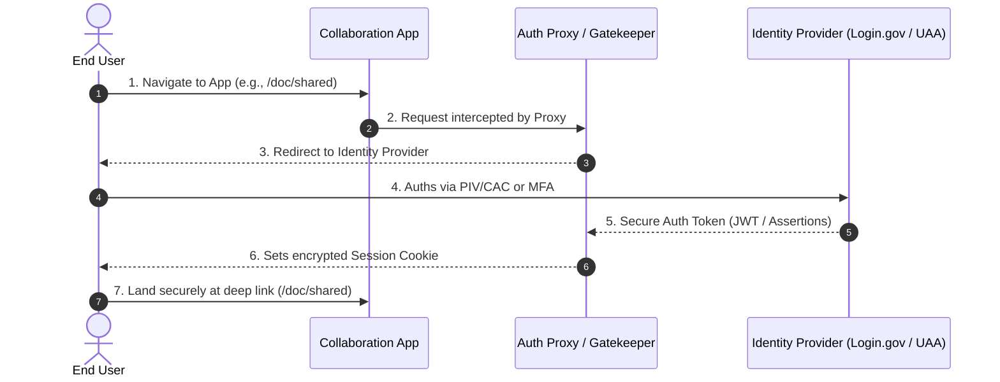
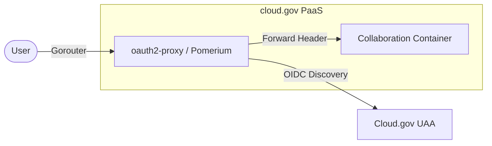
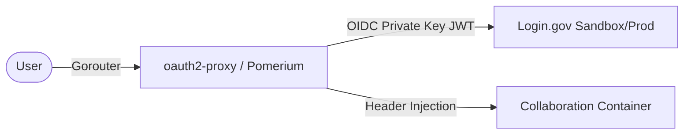
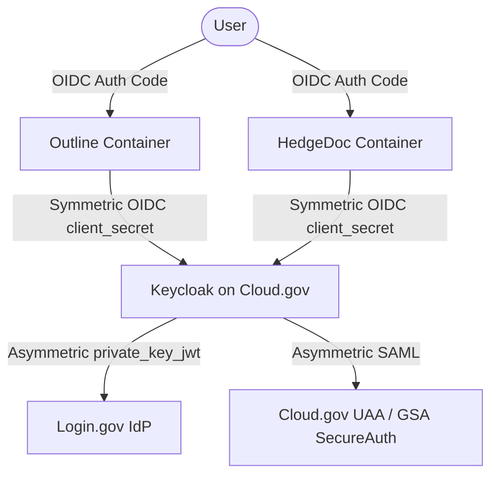

# End-User & Administrator Identity Provider (IdP) Setup Guide

This guide describes the authentication experiences, setup architectures, and administrative tasks for deploying collaboration containers on **Cloud.gov** using **Cloud.gov UAA**, **Login.gov**, or **Keycloak** as the Identity Provider (IdP).

---

## 1. Audience & Setup Persona Mapping

To simplify operations, we categorize this guide into three distinct roles:

* **End-Users (Federal Employees, Contractors, and Public Partners)**: Users who access collaboration tools (like *HedgeDoc, Planka, Outline, or Excalidraw*) to write markdown, manage task boards, or brainstorm.
* **App Administrators (Developers / DevOps Engineers)**: Technical leads responsible for writing manifests, establishing identity links, and deploying proxies on Cloud.gov.
* **Information System Security Officers (ISSOs) / Security Architects**: Compliance and security authorities validating FedRAMP boundaries, identity assurance levels (IAL), and access controls.

---

## 2. The End-User Experience

This section outlines what the end-user experiences when navigating an app protected by our auth-benchmark architectures.

### A. Step-by-Step Login Journey
1. **Initial Access**: The user opens the public URL of the collaboration tool (e.g., `https://hedgedoc.app.cloud.gov`).
2. **Transparent Interception**: If unauthenticated, the user is immediately and transparently redirected to the secure login gateway without seeing the upstream application.
3. **The Login Screen**:
   * **If using Cloud.gov UAA**: The user sees the standard federal Cloud.gov login page. They can authenticate using their GSA email/password or click **Sign in with GSA Secure Auth (PIV/CAC)**.
   * **If using Login.gov**: The user is redirected to the official `secure.login.gov` page, where they enter their email, password, and second-factor authenticator (MFA code, security key, or PIV/CAC card).
   * **If using Keycloak Broker**: The user lands on a custom branded GSA Keycloak login page. They click **Sign in with Login.gov** or **Sign in with Cloud.gov**, proceeding with their federated credentials.
4. **Landing**: Upon successful authentication, the gateway redirects the user back to the application, dropping them off exactly at the deep link or document they originally requested.



### B. Single Sign-On (SSO) & Session Sharing
* **Cross-Application SSO**: If an agency runs multiple tools (such as Outline for documentation and Planka for boards) connected to the same brokered IdP (Keycloak), logging into one tool automatically authenticates the user for all other tools. They will not be prompted to log in again.
* **Single Sign-Out**: When a user logs out of a tool, clicking "Log out" invalidates both the local proxy session and the central session, redirecting them back to a secure landing page and preventing subsequent unauthorized access from shared workstations.

---

## 3. Setup Architecture 1: Cloud.gov UAA as the Identity Provider

**Best For**: Internal agency tools where only active Cloud.gov account holders (developers, managers, or space auditors) require access.



### Administrator Setup Steps

#### Step 1: Create the Cloud.gov Identity Provider Service Instance
Run the following commands using the Cloud Foundry CLI to create a dedicated UAA OAuth client:
```bash
# Define your variables
SERVICE_NAME="collab-hedgedoc-uaa"
REDIRECT_URI="https://collab-hedgedoc.app.cloud.gov/oauth2/callback"

# Create the service instance
cf create-service cloud-gov-identity-provider oauth-client "$SERVICE_NAME" \
  -c "{\"redirect_uri\": [\"$REDIRECT_URI\"]}"
```

#### Step 2: Configure variables and deploy the Auth Proxy
In your auth proxy directory, edit `vars.yml` to bind the proxy to your new service:
```yaml
app_name: collab-hedgedoc-proxy
protected_host: collab-hedgedoc.app.cloud.gov
uaa_service_name: collab-hedgedoc-uaa
upstream_url: http://hedgedoc.apps.internal:8080
cookie_secret: "REPLACE_WITH_SECURE_RANDOM_VALUE"
cookie_domain: collab-hedgedoc.app.cloud.gov
whitelist_domain: .app.cloud.gov
uaa_scope: openid
```

Run the push command:
```bash
cf push
```

#### Step 3: Enforcing User Allow-Lists (UAA Mode)
By default, any user with a Cloud.gov account in the agency's organization can log in. To restrict access to specific email domains or individual lists, configure your `manifest.yml` environment variables:

* **Email Domain Restriction**:
  ```yaml
  OAUTH2_PROXY_EMAIL_DOMAINS: "gsa.gov tts.gsa.gov"
  ```
* **Individual User Whitelist**:
  Create an `authenticated_emails.txt` containing approved emails (one per line) and bundle it in your application directory:
  ```yaml
  OAUTH2_PROXY_AUTHENTICATED_EMAILS_FILE: "authenticated_emails.txt"
  ```

---

## 4. Setup Architecture 2: Login.gov as the Direct Identity Provider

**Best For**: Multi-agency collaboration, public prototyping, or projects where external government partners (without Cloud.gov accounts) need secure access.



### Administrator Setup Steps

#### Step 1: Generate Private/Public Keys
Login.gov requires asymmetric OIDC assertions. Generate an RSA 2048-bit keypair:
```bash
# Generate private key
openssl genpkey -algorithm RSA -out login_private.pem -pkeyopt rsa_keygen_bits:2048

# Extract public key to register with Login.gov
openssl rsa -pubout -in login_private.pem -out login_public.pem
```

#### Step 2: Register on the Login.gov Developer Dashboard
1. Log into the [Login.gov Developer Portal](https://developers.login.gov).
2. Click **Create Integration** and select **OIDC (OpenID Connect)**.
3. Configure the following values:
   * **Issuer (Client ID)**: A unique URI, e.g., `urn:gov:gsa:collab-containers:hedgedoc-staging`
   * **Redirect URI**: `https://collab-hedgedoc.app.cloud.gov/oauth2/callback`
   * **Public Key**: Paste the raw text of `login_public.pem`.
   * **IAL (Identity Assurance Level)**: Select `IAL1` (Standard email/MFA verification).
   * **Attribute Scopes**: Select `openid` and `email`.

#### Step 3: Configure `oauth2-proxy` Environment Variables
To handle the asymmetric `private_key_jwt` signature with Login.gov, convert your `login_private.pem` file to base64, and inject it as a Cloud.gov environment variable:

```bash
# Convert key to a single line base64 string
export LOGINGOV_PRIVATE_KEY_B64=$(base64 -i login_private.pem | tr -d '\n')
```

Bind this base64 string directly to `OAUTH2_PROXY_JWT_KEY` in your Cloud Foundry manifest, or set it via command line:
```bash
cf set-env collab-hedgedoc-proxy OAUTH2_PROXY_JWT_KEY "$LOGINGOV_PRIVATE_KEY_B64"
```

Configure `oauth2-proxy` with the following variables:
```yaml
OAUTH2_PROXY_PROVIDER: "oidc"
OAUTH2_PROXY_CLIENT_ID: "urn:gov:gsa:collab-containers:hedgedoc-staging"
OAUTH2_PROXY_OIDC_ISSUER_URL: "https://idp.sandbox.login.gov"
OAUTH2_PROXY_ACR_VALUES: "http://idmanagement.gov/ns/assurance/ial/1"
OAUTH2_PROXY_SCOPE: "openid email"
OAUTH2_PROXY_INSECURE_OIDC_ALLOW_UNVERIFIED_EMAIL: "true"
```

#### Step 4: Restricting Access via Allow-Lists
To prevent unauthorized Login.gov accounts from logging into your agency's instance, apply the allow-list environment variables in `oauth2-proxy`:
* **Enforce Email Domains**:
  ```yaml
  OAUTH2_PROXY_EMAIL_DOMAINS: "gsa.gov tts.gsa.gov epa.gov"
  ```
* **Enforce Specific Users**:
  ```yaml
  OAUTH2_PROXY_AUTHENTICATED_EMAILS_FILE: "authorized_users.txt"
  ```

---

## 5. Setup Architecture 3: Keycloak as a Centralized Identity Broker

**Best For**: Standard, production-grade enterprise setups where you deploy a suite of collaboration tools (*Outline, Planka, and HedgeDoc* simultaneously). Keycloak acts as the middle-tier OIDC translator.



### Why Choose Keycloak Brokering?
Most collaboration containers **cannot sign asymmetric JWT assertions** required by Login.gov natively. Deploying Keycloak on Cloud.gov solves this elegantly:
1. **Asymmetric-to-Symmetric Bridging**: Keycloak handles the complex asymmetric `private_key_jwt` with Login.gov, but provides standard, simple `client_secret` OIDC endpoints to your collaboration applications.
2. **Unified Enterprise Directory**: Keycloak stores federated profiles, maintains session lifetimes, and manages groups.
3. **Multi-IdP Brokering**: You can present a single login button screen to the user with choices: *"Log in with Login.gov"* (for partners) or *"Log in with GSA SecureAuth (PIV/CAC)"* (for internal employees).

### Administrator Setup Steps

#### Step 1: Deploy Keycloak and bind to PostgreSQL RDS
Deploy Keycloak using the manifest located in `auth-benchmark/keycloak/manifest.yml`. This automatically provisions and binds an `aws-rds` PostgreSQL instance for stable persistence.

#### Step 2: Configure Login.gov in the Keycloak Admin Console
1. Access the Keycloak Admin Console, and navigate to **Identity Providers** in the left-hand menu.
2. Choose **Add Provider...** and select **Login.gov** (natively integrated).
3. Set the following configuration parameters:
   * **Alias**: `login-gov`
   * **Client ID**: `urn:gov:gsa:collab-containers:keycloak-broker`
   * **Issuer (Login.gov)**: `https://idp.sandbox.login.gov` (Sandbox) or `https://secure.login.gov` (Prod).
   * **MFA/Assurance (ACR)**: Set to `http://idmanagement.gov/ns/assurance/ial/1` (IAL1) or `IAL2`.
4. Navigate to **Keys** in Keycloak, export your public key certificate, and paste it into the [Login.gov Developer Portal](https://developers.login.gov) under your Keycloak client registration.

#### Step 3: Register Downstream Collaboration Tools in Keycloak
For each app you want to secure (e.g. Outline):
1. Navigate to **Clients** -> **Create Client**.
2. **Client ID**: `outline-collab`
3. **Client Protocol**: `openid-connect`
4. **Access Type**: `confidential` (requires a client secret).
5. **Valid Redirect URIs**: `https://outline.app.cloud.gov/api/auth.callback`
6. Click Save, and navigate to the **Credentials** tab to copy the generated **Client Secret** (this is a simple symmetric string).
7. Copy this client secret and Keycloak's Issuer URL directly into Outline's standard environment variables (`OIDC_CLIENT_ID`, `OIDC_CLIENT_SECRET`, `OIDC_ISSUER`).

#### Step 4: Enforcing User Allow-Lists in Keycloak
To filter who is allowed to complete the brokered login and access your applications:

##### Enforce Domain Restrictions Globably (Declarative User Profiles)
1. Go to **Realm Settings** -> **User Profile** tab.
2. Select the `email` attribute and edit its validation parameters.
3. Click **Add Validator** and choose **Regular Expression**.
4. Set the Pattern to: `^[^@]+@(gsa\.gov|tts\.gsa\.gov)$`
5. Configure the user-facing error message: *"Access is restricted to authorized government domains."*
6. If an external user tries to log in, Keycloak will halt the registration backchannel and block the login before any downstream app can see the request.

---

## 6. End-User Troubleshooting Guide

This section is designed to assist both users and administrators in resolving common login friction points.

### A. The "SameSite" Cookie Block (Browser-Level Mismatch)
* **Symptom**: After logging in at UAA/GSA SecureAuth, the browser returns a blank page, or loops back to the login page repeatedly.
* **Why it happens**: Modern browsers (especially Safari and Chrome with strict privacy defaults) block cookies on cross-domain POST operations (`SameSite=Lax` or `SameSite=Strict`). When UAA redirects back via a different sub-domain, the session cookie is dropped.
* **Resolution**:
  * **For Users**: Try logging in using an Incognito/Private window, or temporarily disable strict third-party cookie blocking in your browser settings.
  * **For Admins**: Set `OAUTH2_PROXY_COOKIE_SAMESITE="lax"` and ensure you deploy the **Domain Unification** pattern, where your proxy and your application are served on the same parent domain (e.g., `app.cloud.gov`).

### B. "InResponseTo" Error (SAML Session Lost)
* **Symptom**: The browser displays a raw JSON or XML error from UAA: `The response contained an InResponseTo attribute but no saved authentication request was found`.
* **Why it happens**: The user’s session timed out during the physical PIV/CAC card prompt (took longer than 5 minutes), or the browser's cookies were cleared mid-handshake.
* **Resolution**:
  * **For Users**: Close all browser tabs, open a fresh window, and navigate directly to the app URL to re-trigger the handshake. Do not bookmark the Login.gov/UAA redirect screen.

### C. Collaborative Session Timeouts
* **Symptom**: While drafting a document in HedgeDoc, the user suddenly receives "Connection Lost" or "Unauthorised" popups.
* **Why it happens**: The front-end proxy session (`oauth2-proxy` or Keycloak cookie) has expired, but the collaborative editor (running on active WebSockets) is still trying to communicate.
* **Resolution**:
  * **For Users**: Simply duplicate the browser tab. In the new tab, refresh the page to trigger the silent auth-renewal handshake, then return to the original tab and continue typing.
  * **For Admins**: Increase the proxy's cookie duration (`OAUTH2_PROXY_COOKIE_EXPIRE="12h"` or `OAUTH2_PROXY_COOKIE_REFRESH="1h"`) to cover a full working day, or back the proxy with a Redis session store to allow seamless, non-disruptive silent session updates.
