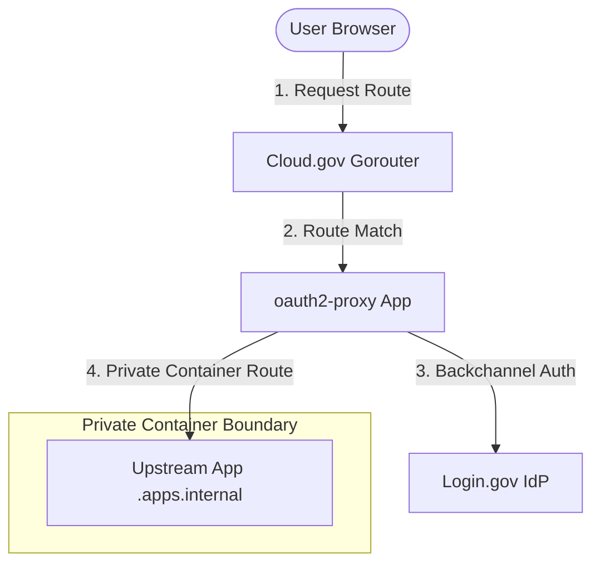

# Integrating Login.gov as an Auth Provider on Cloud.gov

This guide details how to integrate GSA's official authentication provider, **Login.gov**, into the universal authentication proxy architecture on Cloud.gov. 

Login.gov supports OpenID Connect (OIDC) and SAML 2.0 protocols. To comply with federal guidelines and simplify configuration, **OIDC with Asymmetric Client Authentication (`private_key_jwt`)** is the standard and recommended integration model.

---

## Executive Summary & Core Architectural Scenarios

Government applications deployed on Cloud.gov typically fall into two categories of authentication needs. We have tailored our benchmarking and recommendations to support both:

| Metric | Scenario A: "Just Need a Session" (Authentication Gatekeeper / Proxy-Only) | Scenario B: "Full IDP" (Application-Managed Identity / Brokered Identity) |
| :--- | :--- | :--- |
| **Primary Goal** | Prevent unauthenticated public traffic from reaching the app. Abstract all authentication. | Enable collaboration apps to manage user accounts, permissions, shared workspaces, and profile details. |
| **Typical Apps** | Light/Stateless apps with no internal user system (e.g., *Excalidraw, Marimo, Etherpad*). | Rich collaboration suites requiring user-level databases (e.g., *Outline, HedgeDoc, Planka*). |
| **Core Proxy Tool** | `oauth2-proxy` or `pomerium` deployed as a lightweight sidecar. | `keycloak` deployed as a centralized identity broker. |
| **Integration Pattern**| Auth Proxy connects directly to Login.gov; forwards session context via downstream HTTP headers. | Keycloak connects to Login.gov as upstream IdP; downstream apps connect to Keycloak via simple standard OIDC. |
| **Auth Cryptography** | Proxy handles asymmetric `private_key_jwt` directly. | Keycloak handles asymmetric `private_key_jwt`; downstream apps use standard, symmetric `client_secret`. |
| **User Whitelisting** | Restricts access via proxy-level email/domain filters. | Restricts access via Keycloak authentication flows or declarative user profile regexes. |
| **Resource Footprint**| Extremely low (~20MB RAM, stateless). | Medium to High (~1-2GB RAM, requires stateful RDS database). |

---

## 1. Understanding Login.gov Integration Protocol Requirements

Integrating with Login.gov requires adhering to strict security protocols dictated by NIST SP 800-63-3.

### A. Asymmetric Client Authentication (`private_key_jwt`)
Unlike typical OIDC integrations that use a shared symmetric `client_secret`, Login.gov **forbids** static client secrets in production.
* When requesting an access token, your client must construct a JSON Web Token (JWT), sign it using an **asymmetric private key (RSA-256 or ECDSA-256)**, and send this signed JWT as a client assertion to Login.gov's `/api/openid_connect/token` endpoint.
* **The Blocker**: Standard collaboration containers (e.g., Outline, HedgeDoc, Planka) **do not support asymmetric private-key signing** out of the box. They expect a standard symmetric `client_secret` string. This mandates the use of either an **Auth Proxy (Scenario A)** or an **Identity Broker (Scenario B)** to act as the cryptographic gateway.

### B. Login.gov Environments & Endpoint URLs

| Property | Sandbox Environment | Production Environment |
| :--- | :--- | :--- |
| **Developer Portal** | [https://developers.login.gov](https://developers.login.gov) | [https://developers.login.gov](https://developers.login.gov) |
| **Issuer URL** | `https://idp.sandbox.login.gov` | `https://secure.login.gov` |
| **Discovery Endpoint**| `https://idp.sandbox.login.gov/.well-known/openid-configuration` | `https://secure.login.gov/.well-known/openid-configuration` |
| **JWKS Endpoint** | `https://idp.sandbox.login.gov/api/openid_connect/certs` | `https://secure.login.gov/api/openid_connect/certs` |

### C. Authentication Context Class References (ACRs)
Login.gov requires your client to request a specific security profile using the `acr_values` query parameter:
* **IAL1 (Identity Assurance Level 1)**: Verified email + multi-factor authentication.
  * ACR string: `http://idmanagement.gov/ns/assurance/ial/1`
* **IAL2 (Identity Assurance Level 2)**: Full identity verification (requires SSN, ID checks, etc.).
  * ACR string: `http://idmanagement.gov/ns/assurance/ial/2`

---

## 2. Scenario A: "Just Need a Session" (Authentication Gatekeeper / Proxy Mode)

Use this scenario if you want a **lightweight, stateless sidecar** that establishes an authenticated boundary around your app without modifying the application code.



### Step 1: Generate your Private/Public Keypair
Generate a 2048-bit RSA private key to sign the OIDC client assertions. Do **not** secure the key with a passphrase, as the proxy must read it automatically on boot.

```bash
# Generate the private key
openssl genpkey -algorithm RSA -out login_gov_private.pem -pkeyopt rsa_keygen_bits:2048

# Extract the public key in PEM format to register with Login.gov
openssl rsa -pubout -in login_gov_private.pem -out login_gov_public.pem
```

### Step 2: Register the Integration on the Login.gov Dashboard
1. Log into the [Login.gov Developer Portal](https://developers.login.gov).
2. Click **Create Integration**.
3. Fill out the application details and provide:
   * **Issuer**: A unique identifier string (e.g., `urn:gov:gsa:tts:collab-containers:oauth2-proxy-staging`).
   * **Redirect URIs**: Must match your proxy's callback URL precisely:
     * `https://auth-bench-oauth2-proxy.app.cloud.gov/oauth2/callback`
   * **Public Key**: Paste the contents of `login_gov_public.pem` generated in Step 1.
   * **Scopes**: Check `openid` and `email`.

### Step 3: Configure `oauth2-proxy` with User Allow-Lists
`oauth2-proxy` can be configured to enforce access control directly, supporting both **domain-level whitelisting** and **individual email-address allow-lists**.

#### A. Restricting by Email Domain
To allow only users belonging to specific domains (e.g., `@gsa.gov` or `@tts.gsa.gov`):
```bash
OAUTH2_PROXY_EMAIL_DOMAINS="gsa.gov tts.gsa.gov"
```

#### B. Restricting by Individual Email List (Static Allow-list)
To restrict access to a highly specific, static list of approved government employees, we bundle an `authenticated_emails.txt` file inside the deployment:
1. Create a file named `authenticated_emails.txt` inside your deployment directory.
2. List the approved email addresses, one per line:
   ```text
   john.doe@gsa.gov
   jane.smith@tts.gsa.gov
   ```
3. Point `oauth2-proxy` to this file using:
   ```bash
   OAUTH2_PROXY_AUTHENTICATED_EMAILS_FILE="authenticated_emails.txt"
   ```

### Step 4: Complete Cloud.gov manifest for Scenario A
Below is a production-grade Cloud.gov `manifest.yml` for `oauth2-proxy` acting as a Login.gov gatekeeper:

```yaml
applications:
  - name: auth-bench-oauth2-proxy
    memory: 256M
    disk_quota: 512M
    instances: 1
    docker:
      image: example/image:placeholder
    routes:
      - route: auth-bench-oauth2-proxy.app.cloud.gov
    env:
      UPSTREAM_URL: http://auth-bench-fixture-oauth2-proxy-staging.apps.internal:8080
      PROTECTED_HOST: auth-bench-oauth2-proxy.app.cloud.gov
      COOKIE_DOMAIN: auth-bench-oauth2-proxy.app.cloud.gov
      
      # Security Keys (Replace cookie_secret with a 32-byte base64 value)
      OAUTH2_PROXY_COOKIE_SECRET: "REPLACE_WITH_SECURE_RANDOM_VALUE"
      
      # Login.gov OIDC Parameters
      OAUTH2_PROXY_PROVIDER: "oidc"
      OAUTH2_PROXY_CLIENT_ID: "urn:gov:gsa:tts:collab-containers:oauth2-proxy-staging"
      OAUTH2_PROXY_OIDC_ISSUER_URL: "https://idp.sandbox.login.gov"
      OAUTH2_PROXY_ACR_VALUES: "http://idmanagement.gov/ns/assurance/ial/1"
      OAUTH2_PROXY_SCOPE: "openid email"
      OAUTH2_PROXY_INSECURE_OIDC_ALLOW_UNVERIFIED_EMAIL: "true"
      
      # User Whitelisting Configuration
      OAUTH2_PROXY_EMAIL_DOMAINS: "gsa.gov tts.gsa.gov"
      OAUTH2_PROXY_AUTHENTICATED_EMAILS_FILE: "authenticated_emails.txt"
      
      # Downstream Request Header Injection (For the upstream app)
      OAUTH2_PROXY_PASS_HOST_HEADER: "true"
      OAUTH2_PROXY_REVERSE_PROXY: "true"
      OAUTH2_PROXY_SET_XAUTHHEADER: "true" # Injects X-Auth-Email and X-Auth-User
      
      # Session Security
      OAUTH2_PROXY_COOKIE_SECURE: "true"
      OAUTH2_PROXY_COOKIE_SAMESITE: "lax"
      OAUTH2_PROXY_SKIP_PROVIDER_BUTTON: "true"
    command: |
      set -eu
      export PORT="${PORT:-4180}"
      export OAUTH2_PROXY_HTTP_ADDRESS="0.0.0.0:${PORT}"
      export OAUTH2_PROXY_REDIRECT_URL="https://${PROTECTED_HOST}/oauth2/callback"
      export OAUTH2_PROXY_UPSTREAMS="${UPSTREAM_URL}"
      
      # Write the private key from an environment variable or retrieve it from an attached secret
      # For demo safety, we read the base64-encoded private key from OAUTH2_PROXY_JWT_KEY
      if [ -n "${OAUTH2_PROXY_JWT_KEY:-}" ]; then
        echo "$OAUTH2_PROXY_JWT_KEY" | base64 -d > /tmp/login_gov_private.pem
        export OAUTH2_PROXY_JWT_KEY_FILE="/tmp/login_gov_private.pem"
      fi

      exec oauth2-proxy
```

---

## 3. Scenario B: "Full IDP" (Centralized Brokered Identity)

Use this scenario if your collaboration suite consists of multiple identity-aware applications (such as **Outline**, **HedgeDoc**, or **Planka**) that require rich, persistent database accounts, user-profile synchronization, and single sign-on (SSO).

```mermaid
graph TD
    User([User Browser]) -->|1. Access App| Outline[Outline App]
    Outline -->|2. Redirect OIDC (Symmetric)| Keycloak[Keycloak Broker]
    Keycloak -->|3. Redirect OIDC (Asymmetric private_key_jwt)| LoginGov[Login.gov IdP]
    LoginGov -.->|4. Authenticates User| User
    LoginGov -->|5. Assertion Callback| Keycloak
    Keycloak -->|6. Profile Sync & JWT Token| Outline
```

### Why Keycloak is Critical for this Scenario
Keycloak serves as the perfect "translator":
1. It registers with Login.gov using asymmetric `private_key_jwt` keys.
2. It receives federated credentials, provisions a user account in its local PostgreSQL database, and maps incoming attributes (like Login.gov `sub` as unique user identifier and `email`).
3. It exposes standard OIDC endpoints to collaboration containers using basic **symmetric client secrets** (which are globally compatible with Outline, HedgeDoc, and Planka out of the box).
4. Users log in once via Login.gov, and gain seamless SSO access across all TTS collaboration containers linked to Keycloak.

### Step-by-Step Keycloak & Login.gov Integration

#### Step 1: Generate Cryptographic Credentials in Keycloak
1. Deploy Keycloak on Cloud.gov (linked to an `aws-rds` instance).
2. Log into the Keycloak Admin Console, choose your realm, and navigate to **Keys** -> **Active**.
3. Keycloak will automatically maintain RSA keys. You can also generate a custom keypair under your Realm settings.
4. Go to **Identity Providers** in the left sidebar and select **Login.gov** (natively supported starting in Keycloak 20+).
5. In the Login.gov config, you can obtain Keycloak's public key (JWKS endpoint or raw certificate) to upload to the Login.gov developer portal.

#### Step 2: Register on the Login.gov Dashboard
1. Under [Login.gov Developer Portal](https://developers.login.gov), register your Keycloak server.
2. **Issuer**: (e.g., `urn:gov:gsa:tts:collab-containers:keycloak-broker-staging`).
3. **Redirect URI**: Set to your Keycloak callback endpoint:
   * `https://auth-bench-keycloak.app.cloud.gov/auth/realms/{YOUR_REALM}/broker/login-gov/endpoint`
4. Paste the public key or link Keycloak’s JWKS endpoint.

#### Step 3: Enforcing User Allow-Lists in Keycloak
To restrict who can log in through the central Keycloak broker, you can implement either of the following patterns:

##### Pattern A: Declarative User Profile Email Validation (Recommended)
This pattern enforces domain restrictions globally when Keycloak registers users federating from Login.gov.
1. In Keycloak Admin, go to **Realm Settings** -> **User Profile** tab.
2. Select the `email` attribute and edit its validation rules.
3. Add a **Regular Expression** validator:
   * Pattern: `^[^@]+@(gsa\.gov|tts\.gsa\.gov)$`
   * Error message: *"Access is restricted to authorized government email domains (@gsa.gov or @tts.gsa.gov)."*
4. Keycloak will block any Login.gov authentication backchannel if the user's email fails this validation.

##### Pattern B: Conditional Authentication Flow (Static Email Allow-list)
If you need to limit access strictly to a static list of authorized email addresses:
1. Navigate to **Authentication** -> **Flows** in Keycloak.
2. Duplicate the default `First Broker Login` flow.
3. Add a conditional check: **Condition - User Attribute**.
4. Configure the condition to match an approved attribute, or write a lightweight **JavaScript Authenticator** (if enabled via `--features=scripts` on Cloud.gov) to check the incoming email against an allowed list:
   ```javascript
   function authenticate(context) {
       var user = context.getUser();
       var allowedEmails = ["john.doe@gsa.gov", "jane.smith@tts.gsa.gov"];
       if (allowedEmails.indexOf(user.getEmail()) > -1) {
           context.success();
       } else {
           context.failure(AuthenticationFlowError.INVALID_USER);
       }
   }
   ```

---

## 4. Benchmarking & Detailed Comparison Matrix

To help your engineering team decide between Scenario A and Scenario B, we have evaluated them across crucial engineering metrics on Cloud.gov:

| Evaluation Axis | Scenario A: Auth Proxy (oauth2-proxy) | Scenario B: Brokered IDP (Keycloak) |
| :--- | :--- | :--- |
| **Deployability / Ease of Setup** | **High** (Configured fully via CF Manifest env variables; completely automated). | **Medium** (Requires initial manual Keycloak Admin UI setup and RDS provisioning). |
| **Operational Overhead** | **Extremely Low** (Stateless, no database dependencies, no patching required). | **High** (Requires managing stateful DB backups, patching JRE/Keycloak image). |
| **App Compatibility** | **High** (Wraps any app completely, but downstream apps don't manage individual profiles natively). | **Universal** (Presents a standard `client_secret` OIDC endpoint to downstream apps). |
| **RAM Footprint** | **~20MB - 32MB** | **~1GB - 2GB** |
| **Single Sign-On (SSO)** | Limited (SSO is isolated to a single domain cookie). | **Robust** (Provides global SSO across all connected collaboration tools). |
| **Access Control Granularity**| **Basic** (Enforces binary Access/No-Access at the proxy gateway). | **Advanced** (Enforces role-based permissions, group mappings, attribute synchronization). |
| **FedRAMP & Compliance** | Highly compliant (thin wrapper, secure cookies). | Highly compliant (Enterprise identity standard, detailed audit logging). |

---

## 5. Architectural Recommendations for GSA TTS Teams

1. **For General/Ad-Hoc Prototyping (Low Overhead): Choose Scenario A (oauth2-proxy)**
   If you are spinning up individual instances of *Excalidraw*, *HedgeDoc*, or *Marimo* for rapid sandboxing, use `oauth2-proxy` configured with Login.gov. It requires zero database instances, boots instantly, runs within 256M of RAM, and supports domain-level/email-level allow-lists straight from the environment config.
   
2. **For Production-grade, Multi-App Suites: Choose Scenario B (Keycloak Broker)**
   If you are building an integrated collaboration workspace (e.g., providing *both* Outline and HedgeDoc to a large team), deploy Keycloak as your broker. This allows you to centralize Login.gov asymmetric key administration in one place. Your collaboration containers can then talk standard, symmetric OIDC to Keycloak, making deployment of standard container images simple and maintainable while facilitating unified SSO.
