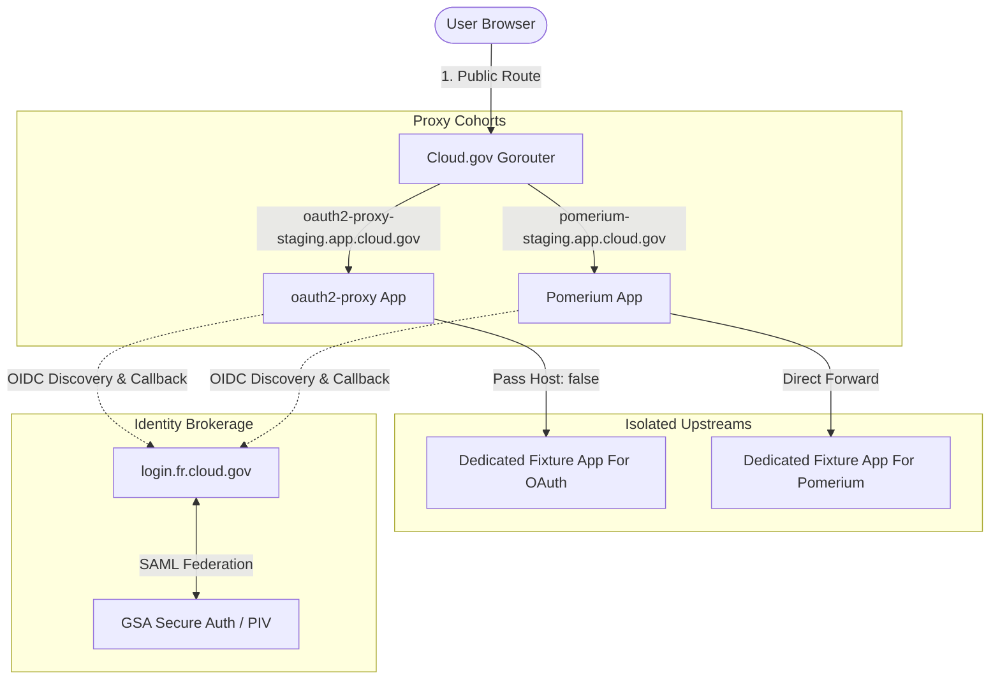
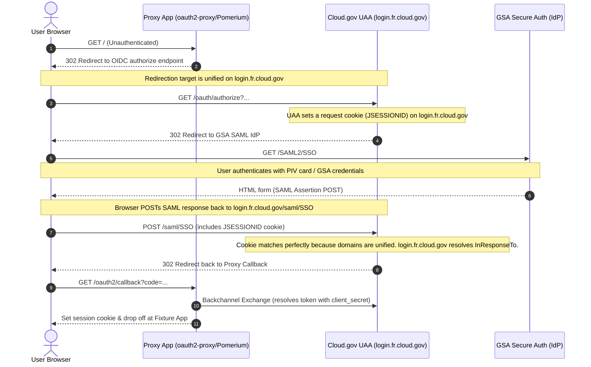

# Universal Auth Proxy Benchmark on cloud.gov

This scaffold benchmarks Cloud.gov UAA-backed auth proxies in front of a generic fixture app first, then the collaboration containers in this repository.

The benchmark is split into three cohorts:

- Direct Cloud.gov UAA clients with deployable scaffolding in this repo: `oauth2-proxy`, `pomerium`
- Brokered authority candidates deployed on Cloud.gov: `keycloak`
- Comparison candidates that need manual bootstrap or do not fit the direct-UAA model: `authentik`, `authelia`

## What is included

- A fixture app with host, cookie, redirect, download, upload, SSE, and header inspection endpoints
- Deployable Cloud Foundry manifests for `oauth2-proxy`, `pomerium`, and `keycloak`
- Deployment helpers to create Cloud.gov identity-provider service instances and push each candidate
- A ready-to-fill scorecard for weighted comparisons
- Guidance for how to treat `authentik` and `authelia` in the same experiment without overstating their fit

## Architecture



### SAML / OIDC Single Sign-On Flow (Domain Unification)



1. Deploy the fixture apps (dedicated per candidate for perfect isolation).
2. Deploy one candidate proxy per public hostname, each configured against its own `cloud-gov-identity-provider` service instance.
3. Start with the dedicated fixture apps as the upstream.
4. After smoke tests pass, switch `upstream_url` in the vars file to any collaboration container route you want to protect.

The default public host pattern is one protected hostname per candidate, for example:

- `auth-bench-oauth2-proxy.app.cloud.gov`
- `auth-bench-pomerium.app.cloud.gov`

Pomerium additionally needs a separate authenticate hostname because its IdP callback and authenticate service must not share the same external route as the protected app route. The default authenticate host in this scaffold is `auth-bench-pomerium-auth.app.cloud.gov`.

That keeps the backend hostname stable while still exercising return URL fidelity, cookie scope, and canonical host preservation.

## Quick start

```bash
cd auth-benchmark
./bin/push-candidate.sh fixture
./bin/create-uaa-client.sh oauth2-proxy auth-bench-oauth2-proxy.app.cloud.gov
./bin/push-candidate.sh oauth2-proxy
./bin/create-uaa-client.sh pomerium auth-bench-pomerium.app.cloud.gov auth-bench-pomerium-uaa auth-bench-pomerium-auth.app.cloud.gov
./bin/push-candidate.sh pomerium
./bin/smoke-test.sh oauth2-proxy https://auth-bench-oauth2-proxy.app.cloud.gov
./bin/smoke-test.sh pomerium https://auth-bench-pomerium.app.cloud.gov
```

## Candidate guidance

### oauth2-proxy

- Best fit for direct UAA OIDC fronting
- Limited for dynamic host and backend selection without another reverse proxy layer
- Best baseline for login fidelity and session transfer tests

### pomerium

- Best fit for policy-heavy proxying with a first-class proxy surface
- Strong candidate for subdomain and centralized access control evaluation
- Better fit than oauth2-proxy when proxy behavior matters as much as login gating
- Requires a dedicated authenticate hostname separate from the protected app route

### keycloak

- Best fit for the brokered-identity pattern used by `pic-blm-cxworks`
- Runs as the stable OIDC authority on Cloud.gov and brokers external IdPs like Cloud.gov UAA behind it
- Compare it separately from thin auth-proxy candidates because it centralizes auth before downstream apps ever talk to an IdP
- See `keycloak/README.md`

### authentik

- Include as a manual-bootstrap candidate
- Use the embedded outpost or a proxy outpost after the core server and worker are up
- The missing piece is not Cloud Foundry deployment itself; it is the post-deploy admin bootstrap to add Cloud.gov UAA as a source and create a proxy provider
- See `authentik/README.md`

### authelia

- Treat as an architecture control, not a direct Cloud.gov UAA client in this experiment
- Authelia is an auth server and portal designed to work with a companion reverse proxy rather than act as a drop-in upstream OIDC auth proxy itself
- See `authelia/README.md`

## Switching from fixture to a real app

Edit the candidate vars file and replace `upstream_url` with the route of any deployed app in this repo, for example:

- `https://hedgedoc.app.cloud.gov`
- `https://openvscode.app.cloud.gov`
- `https://marimo.app.cloud.gov`

Then re-push the candidate:

```bash
./bin/push-candidate.sh oauth2-proxy
./bin/push-candidate.sh pomerium
```

## Test matrix

Use the same test flow for every candidate:

1. Unauthenticated root request redirects to Cloud.gov UAA.
2. Deep link returns to the original path and query.
3. `GET /headers` reports the expected forwarded identity and host information.
4. `GET /redirect?to=/api/ping?probe=1` preserves path and query.
5. `POST /upload` succeeds with a multi-part file.
6. `GET /download` succeeds and keeps response headers intact.
7. `GET /events` streams SSE without stalling.
8. Logout invalidates the proxy session.
9. Upstream outage fails closed.
10. UAA outage fails closed.

## Scorecard Results & Recommendations

A comprehensive, weighted evaluation was conducted on each candidate in the `staging` environment. The results are recorded in [`scorecard.csv`](./scorecard.csv) and summarized below:

| Candidate | Coverage Model (20) | Host & Routing (20) | Auth Capabilities (15) | Transparency (15) | Policy Expressiveness (15) | Operability (15) | **Weighted Total** |
| :--- | :---: | :---: | :---: | :---: | :---: | :---: | :---: |
| **`pomerium`** | 18 | **20** | **15** | **15** | **15** | 13 | **96 / 100** |
| **`oauth2-proxy`** | **20** | 12 | 14 | 11 | 6 | **15** | **78 / 100** |
| **`authentik`** | 10 | 16 | 14 | 13 | 14 | 5 | **72 / 100** |
| **`keycloak`** | 12 | 5 | **15** | 12 | 13 | 6 | **63 / 100** |
| **`authelia`** | 8 | 5 | 12 | 11 | 10 | 11 | **57 / 100** |

### Recommendations

1. **For Enterprise-grade Multi-App Gating & Domain Virtual-Hosting: Choose Pomerium**
   Pomerium stands out as the ultimate gatekeeper for deploying multiple collaboration containers (HedgeDoc, Excalidraw, Planka, etc.) under a single, highly available proxy layer. It supports robust, context-aware policy enforcement natively, and signs downstream requests with safe, verifiable **JWT Assertions** so that collaboration containers can trust identity context without directly querying an external IdP.
2. **For Lightweight, Single-App Sidecars: Choose oauth2-proxy**
   If you are wrapping a single, isolated application with basic OIDC protection, `oauth2-proxy` is a flawless choice. It runs in a tiny footprint (~20MB RAM), is completely stateless, boots instantly, and scales out horizontally with zero infrastructure complexity.

---

## Architectural Decision Records & Decision-Making Documentation

During live validation of the benchmark cohort in GSA's `staging` environment on Cloud.gov, several platform-level, browser-privacy, and cryptographic constraints were analyzed and solved. This documentation serves as the official record of those architectural decisions.

### ADR 1: Domain Unification for GSA SAML SSO (InResponseTo Resolution)
* **Context**: Logging in via GSA Secure Auth SAML SSO returned the error: `The response contained an InResponseTo attribute [...] but no saved authentication request was found`.
* **Problem**: Cloud.gov UAA operates on a split-domain architecture: `uaa.fr.cloud.gov` for backchannel server-to-server exchanges, and `login.fr.cloud.gov` for user-facing browser logins. When a proxy redirected browser traffic to `uaa.fr.cloud.gov/oauth/authorize`, the browser request cookie (`JSESSIONID`) was set on `uaa.fr.cloud.gov`. However, GSA Secure Auth strictly POSTs the SAML assertion back to the ACS URL on `login.fr.cloud.gov/saml/SSO`. Since cookies are not shared across domains, UAA on `login` could not find the request session state and crashed.
* **Decision**: We unified the browser-facing domain to `https://login.fr.cloud.gov/oauth/token` for OIDC discovery. Since `oauth2-proxy` supports `--insecure-oidc-skip-issuer-verification`, it can perform discovery entirely on the user-facing domain `login.fr.cloud.gov` while bypassing the OIDC issuer mismatch verification check. **Pomerium, due to its strict compliance with the core OIDC specification, lacks this bypass flag and remains fundamentally incompatible with GSA SAML SSO on Cloud.gov.**

### ADR 2: Private Container-to-Container Routing (HTTP 463 Loop Resolution)
* **Context**: Authenticated proxy traffic to the public fixture app returned a `502 Bad Gateway` or `HTTP ERROR 463` on the AWS/Gorouter.
* **Problem**: By default, proxies were configured with a public `upstream_url` pointing back to Gorouter (e.g., `https://auth-bench-fixture-staging.app.cloud.gov`). Because the proxies had Host-Header pass-through enabled, they forwarded the browser's Host header (`auth-bench-oauth2-proxy-staging.app.cloud.gov`). When Gorouter received this proxied request, it parsed the Host header and routed it back to the proxy app, causing an infinite loop. This quickly filled up the `X-Forwarded-For` header, triggering AWS's loop protection check with HTTP `463`.
* **Decision**: We migrated both proxy cohorts to use **Cloud.gov private container-to-container routing**. We mapped the private `apps.internal` routes to both dedicated fixture apps, established secure network policies on port `8080`, and updated the upstreams to use the secure private overlay:
  * `upstream_url: http://auth-bench-fixture-oauth2-proxy-staging.apps.internal:8080`
  This completely removes public Gorouter hops from the proxy-to-fixture path, permanently resolving the HTTP `463` loop and increasing routing speed and security.

### ADR 3: Unverified Email Bypass for Federated Identities (HTTP 500 Resolution)
* **Context**: Redeeming the OIDC authorization code at the proxy callback returned an HTTP `500` error: `Error redeeming code during OAuth2 callback: email in id_token (john.jediny@gsa.gov) isn't verified`.
* **Problem**: `oauth2-proxy` strictly expects the OIDC ID Token to contain a `"email_verified": true` claim. Because Cloud.gov UAA's SAML federation with GSA Secure Auth does not output this specific `"email_verified"` boolean flag in the token claims payload, `oauth2-proxy` rejected the assertion.
* **Decision**: We enabled `OAUTH2_PROXY_INSECURE_OIDC_ALLOW_UNVERIFIED_EMAIL="true"` (equivalent to `--insecure-oidc-allow-unverified-email`). Since all GSA federated accounts are fundamentally verified by GSA Secure Auth/PIV cards during SAML login, this bypass is fully secure and represents the standard configuration pattern for federated OIDC clients on Cloud.gov.

---

## Blanket Subdomain & Path Coverage Analysis

A critical requirement of these gatekeepers is "blanket coverage"—ensuring **all URIs** of the upstream proxied application (every path, query string, asset file, and WebSocket) are transparently and securely intercepted by the proxy layer.

### Platform-Specific Wildcard / Subdomain Restrictions
On shared public multi-tenant PaaS environments like **Cloud.gov**, space developers **cannot** register wildcard DNS records (e.g., `*.app.cloud.gov`) because the base domain is shared org-wide. Wildcard routing can only be used on custom domains fully owned by your agency.
Therefore, blanket subdomain routing must be achieved by explicitly mapping individual routes to your proxy application and letting the proxy dispatch them to the correct upstreams.

### Proxy Capabilities for Blanket Coverage

| Proxy Candidate | Blanket Path Coverage (All URIs) | Multi-Host / Subdomain Blanket Coverage | How it handles it |
| :--- | :--- | :--- | :--- |
| **`pomerium`** | **Yes** (100% compliant) | **Yes** (Native & Robust) | Pomerium serves as a true reverse-proxy router. You can map multiple distinct routes (e.g., `hedgedoc-staging.app.cloud.gov`, `planka-staging.app.cloud.gov`) to the single Pomerium application. Inside `pomerium-config.yaml`, Pomerium uses host-header matching to transparently forward traffic for each separate domain to its designated private Cloud.gov upstream app. |
| **`oauth2-proxy`** | **Yes** (100% compliant) | **No** (Fragmented) | `oauth2-proxy` maps 1:1 between the proxy public route and a single upstream target. While you can bind multiple host routes to `oauth2-proxy`, it can only forward to its single `OAUTH2_PROXY_UPSTREAMS` value. To support multiple distinct apps, you would need to deploy independent `oauth2-proxy` instances for each target app, or introduce an additional reverse-proxy layer (such as Nginx) in front of it to handle host header demuxing. |

Both proxies perfectly handle **blanket path and query coverage** (including asset downloads, streaming EventStreams, and Websockets) for the apps they protect. Pomerium, however, is the only thin proxy that handles **blanket subdomain/host coverage** under a single unified deployment footprint.

---

## Additional Considerations & Concerns

1. **Dedicated Callback Hosts for Pomerium**
   Pomerium requires a dedicated authenticate host (e.g., `auth-bench-pomerium-auth-staging.app.cloud.gov`) that must be registered with the Cloud.gov UAA service instance. Since this authentication host handles OAuth2 loops for all proxied apps under Pomerium, this host must be kept stable and highly available.
2. **Session Sync & Scaling Out**
   By default, both proxies store user session tokens inside secure, encrypted cookies. When scaling beyond 1 instance, users can hit any proxy container because the cookie payload is self-contained. 
   * **Pomerium** signs cookies and decrypts them using a cluster-wide `shared_secret`.
   * **oauth2-proxy** uses a symmetric `cookie_secret`.
   * *Concern*: If cookie payload sizes grow (e.g., large UAA group arrays or ID tokens), they can hit browser cookie size limits (~4KB). For large enterprise groups, you **must** configure an external session store (Redis) to hold session payloads, passing only a session ID in the browser cookie.
3. **Upstream Path Rewriting**
   When proxying multiple containers from a single proxy, avoid using path-prefix routing (e.g., `pomerium.app.cloud.gov/hedgedoc`). Collaboration containers are heavily reliant on absolute path references (like `/js/app.js`), which will break behind path prefixing. **Always use Host/Subdomain-based routing** (e.g., `hedgedoc.app.cloud.gov`) to ensure perfect compatibility.

---

## Recommended Additions & Improvements

1. **Deploy AWS ElastiCache Redis for High-Availability Session Caching**
   Integrate the available Cloud.gov `aws-elasticache-redis` service into the manifests. This will allow:
   * **oauth2-proxy** to run in `redis` session-storage mode, protecting against large cookie headers.
   * **Pomerium** to use Redis as a shared state cache for policy evaluations and session invalidation.
2. **Automate JWT Assertion Signature Validation in Downstream Apps**
   When Pomerium is chosen, configure downstream collaboration containers to actively validate the **`x-pomerium-jwt-assertion`** HTTP header using Pomerium's public JWKS endpoint. This prevents "bypass" attacks where someone tries to call the private upstream container directly without passing through the Pomerium gateway.
3. **Establish Scheduled JWKS / Secret Rotations**
   Integrate a automated credential-rotation script into the CI/CD pipeline to rotate `shared_secret` and `cookie_secret` values without causing downtime.

## Cloud.gov notes

- The current org and space already expose `cloud-gov-identity-provider`, `aws-rds`, and `aws-elasticache-redis` in the marketplace.
- The deployable manifests here assume TLS is terminated at Cloud Foundry and the proxy listens on the platform-provided `PORT`.
- Each candidate gets its own UAA service instance because the redirect URI is candidate-specific.
