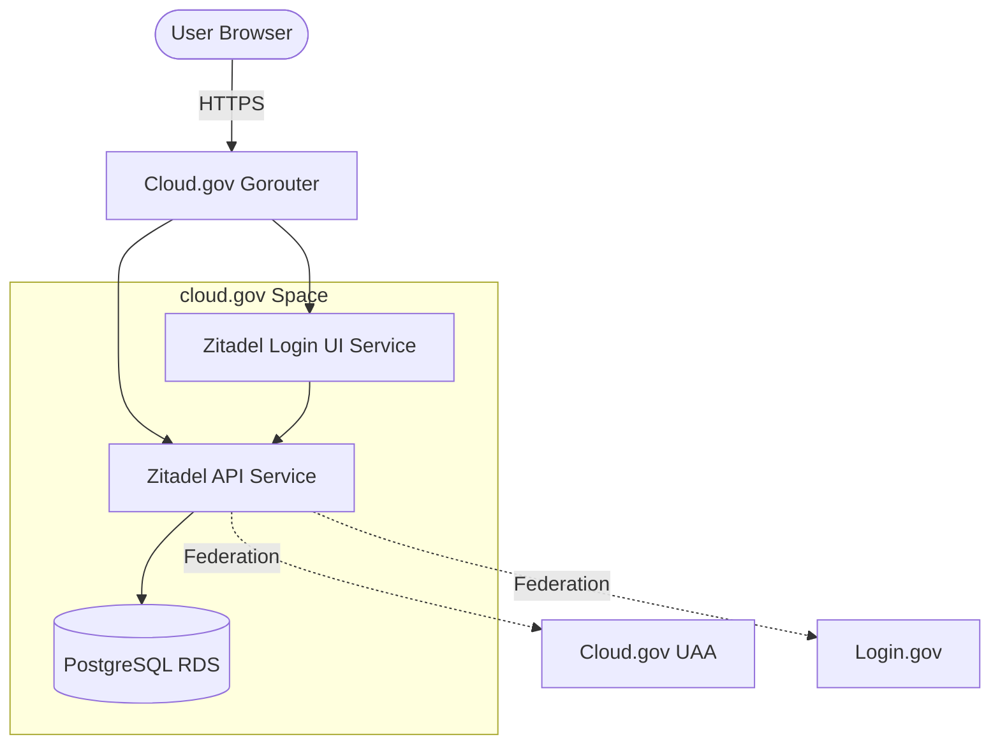
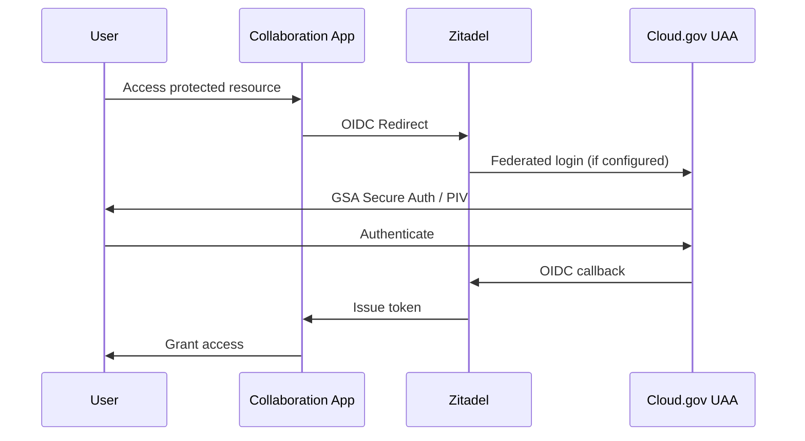

# Zitadel on cloud.gov

[Zitadel](https://zitadel.com/) is an open-source identity and access management platform built for multi-tenancy, offering SSO, MFA, Passkeys, OIDC, SAML, and SCIM out of the box. This directory contains deployment configurations for running Zitadel on cloud.gov as part of the auth benchmark evaluation.

---

## Benchmark Classification

**Cohort**: Brokered authority candidate (similar to Keycloak)

Zitadel operates as a **full identity provider/broker**, not a thin auth proxy. It can:
- Act as the central OIDC/SAML authority for downstream apps
- Broker external IdPs (Cloud.gov UAA, Login.gov, GSA Secure Auth)
- Provide multi-tenant organization management
- Handle user provisioning, MFA, and session management

### Comparison with Keycloak

| Feature | Zitadel | Keycloak |
|---------|---------|----------|
| Language | Go | Java |
| Memory footprint | ~256MB-512MB | ~1-2GB |
| Database | PostgreSQL (event-sourced) | PostgreSQL/MySQL |
| Startup time | Fast (~10-30s) | Slow (~60-120s) |
| Multi-tenancy | Native (Instances > Orgs > Projects) | Realms |
| API-first | gRPC + REST | REST only |
| Horizontal scaling | Native, no external session store | Requires Infinispan/Redis |
| License | AGPL-3.0 | Apache 2.0 |

---

## Architecture on cloud.gov

Zitadel v4.x uses a multi-service architecture:



### Components

1. **Zitadel API** (`ghcr.io/zitadel/zitadel`) - Core identity service handling OIDC/SAML, user management, and API
2. **Zitadel Login** (`ghcr.io/zitadel/zitadel-login`) - Modern Next.js login UI (Login V2)
3. **PostgreSQL** - Event-sourced database for all state

---

## Deployment Challenges on cloud.gov

### Known Limitations

1. **Multi-container coordination**: Zitadel requires two containers (API + Login) that need to share bootstrap state
2. **Traefik dependency**: Default compose uses Traefik for routing; cloud.gov uses Gorouter
3. **Internal networking**: Login service needs to reach API service via container-to-container networking
4. **Masterkey management**: Requires exactly 32-character masterkey for encryption

### Recommended Approach

Due to the complexity of Zitadel's multi-service architecture, consider:

1. **Option A: Single combined deployment** - Use the API container with embedded legacy login (if still supported)
2. **Option B: Dual app deployment** - Deploy API and Login as separate cf apps with network policies
3. **Option C: Docker Compose overlay** - Run locally for evaluation, defer cloud.gov deployment

---

## Quick Start (Local Evaluation)

For benchmarking purposes, start with local Docker Compose:

```bash
# Download compose files
curl -LO https://raw.githubusercontent.com/zitadel/zitadel/main/deploy/compose/docker-compose.yml
curl -LO https://raw.githubusercontent.com/zitadel/zitadel/main/deploy/compose/.env.example
cp .env.example .env

# Start Zitadel
docker compose up -d --wait

# Access at http://localhost:8080
# Default admin: see console output for initial credentials
```

---

## Cloud.gov Deployment (Experimental)

### Current Conclusion

Zitadel is **not currently a viable Docker-based deployment on cloud.gov** in this repository's staging space.

Multiple wrapper-image approaches were validated against cloud.gov and all failed with the same runtime symptom:

```text
/app/zitadel: line 1: ELF... not found
syntax error: unexpected "("
```

That failure persisted across:

1. Distroless wrapper images
2. Wrapper images with copied `busybox` and `ld-musl-x86_64.so.1`
3. Wrapper images with explicit `/bin/sh` launchers
4. Alpine-based wrapper images with a copied amd64 `zitadel` binary
5. Manifest command changes that explicitly invoked `/start.sh`

The practical conclusion for this benchmark is:

1. **Stop iterating on Docker-based cloud.gov deployment for Zitadel** unless there is a strong reason to continue.
2. Treat Zitadel as a **local / Docker Compose evaluation candidate** for feature comparison.
3. If cloud.gov deployment must be pursued, the next bounded experiment should be a **source-based Go buildpack attempt**, not another Docker wrapper iteration.

### Recommendation For This Benchmark

- **Deployment status on cloud.gov**: Blocked
- **Local evaluation status**: Still viable
- **Brokered-identity feature review**: Still worthwhile
- **Operational fit for cloud.gov**: Currently poor compared with Keycloak and thinner proxy patterns

### Prerequisites

```bash
# Create PostgreSQL database
cf create-service aws-rds micro-psql zitadel-db

# Wait for provisioning
cf service zitadel-db
```

### Environment Variables

Key configuration for cloud.gov:

```yaml
env:
  # Domain configuration
  ZITADEL_EXTERNALDOMAIN: zitadel-staging.app.cloud.gov
  ZITADEL_EXTERNALPORT: 443
  ZITADEL_EXTERNALSECURE: "true"
  
  # Security (generate with: openssl rand -hex 16)
  ZITADEL_MASTERKEY: "your-32-character-masterkey-here"
  
  # Database (injected from VCAP_SERVICES)
  # ZITADEL_DATABASE_POSTGRES_DSN: parsed at runtime
  
  # Disable TLS (terminated at Gorouter)
  ZITADEL_TLS_ENABLED: "false"
```

### Manifest Structure

```yaml
applications:
  # Zitadel API Service
  - name: zitadel-api-staging
    memory: 512M
    disk_quota: 1G
    instances: 1
    docker:
      image: ghcr.io/zitadel/zitadel:v4.15.0
    routes:
      - route: zitadel-staging.app.cloud.gov
      - route: zitadel-api-staging.apps.internal
    services:
      - zitadel-db
    command: |
      # Parse VCAP_SERVICES and start
      # See manifest.yml for full implementation
    env:
      ZITADEL_EXTERNALDOMAIN: zitadel-staging.app.cloud.gov
      # ... additional env vars

  # Zitadel Login UI Service  
  - name: zitadel-login-staging
    memory: 256M
    disk_quota: 512M
    instances: 1
    docker:
      image: ghcr.io/zitadel/zitadel-login:v4.15.0
    routes:
      - route: zitadel-staging.app.cloud.gov/ui/v2/login
    env:
      ZITADEL_API_URL: http://zitadel-api-staging.apps.internal:8080
      NEXT_PUBLIC_BASE_PATH: /ui/v2/login
```

### Agent Instructions For `cf push`

The assistant cannot run `cf` in the user's authenticated environment. When resuming work on Zitadel in cloud.gov, use this exact operator flow.

1. Confirm Cloud Foundry target:

```bash
cf target
```

Expected target:

- API: `https://api.fr.cloud.gov`
- org: `<your-org>`
- space: `staging`

2. Confirm the database service exists:

```bash
cf service zitadel-db
```

3. Push the API app from this directory:

```bash
cf push zitadel-api-staging --vars-file vars.yml -f manifest.yml
```

4. Inspect the deployed process definition:

```bash
cf app zitadel-api-staging
cf curl "/v3/apps/$(cf app zitadel-api-staging --guid)/processes"
```

5. Retrieve recent logs:

```bash
cf logs zitadel-api-staging --recent
```

6. If the API app starts successfully, push the login app from the same manifest:

```bash
cf push zitadel-login-staging --vars-file vars.yml -f manifest.yml
cf logs zitadel-login-staging --recent
```

7. Record the outcome in this README before starting another experimental path.

Stop conditions for agents and operators:

1. If logs show `/app/zitadel: line 1: ELF... not found`, stop further Docker-image tweaking and document the failed image tag.
2. If the process command in `cf curl` differs from the manifest expectation, inspect the manifest and re-push once.
3. If the binary starts and a new application-level error appears, continue only on that new error.
4. Do not continue adding more wrapper images without a new technical hypothesis.

### Known Issues

1. **Cloud Foundry Docker lifecycle startup incompatibility**
   - Repeated app starts ended with the shell interpreting `/app/zitadel` as text.
   - Representative cloud.gov log output:

   ```text
   /app/zitadel: line 1: ELF... not found
   /app/zitadel: line 8: syntax error: unexpected "("
   ```

2. **Distroless upstream image complicates Cloud Foundry command execution**
   - Upstream `ghcr.io/zitadel/zitadel:v4.15.0` is distroless.
   - Cloud Foundry troubleshooting often assumes shell access, which distroless images do not provide.

3. **ARM Mac to cloud.gov amd64 image path adds friction**
   - cloud.gov expects `linux/amd64`.
   - Local development occurred on Apple Silicon, which forced cross-platform image work.

4. **`docker buildx` registry TLS verification issue**
   - Observed error:

   ```text
   tls: failed to verify certificate: x509: certificate signed by unknown authority
   ```

   - This blocked straightforward multi-stage or cross-platform pulls from registries.

5. **Read-only filesystem friction during image experiments**
   - Earlier launcher patterns attempted to write files dynamically and failed with permission errors.

6. **Multi-service Zitadel topology is harder to fit into shared CF than thin proxies**
   - API and Login UI are separate services.
   - That adds routing and coordination overhead before federation work even begins.

### Learnings

1. **Manifest command changes were not the root cause**
   - The Cloud Foundry process definition reflected updated commands correctly.
   - The startup failure persisted even when the manifest explicitly invoked `/bin/sh -c 'exec /start.sh ...'`.

2. **A shell wrapper alone is insufficient**
   - Adding `/bin/sh`, `busybox`, `musl`, or an Alpine wrapper did not resolve the binary execution failure on cloud.gov.

3. **The issue appears to be runtime/platform compatibility, not simple YAML misconfiguration**
   - After several distinct image strategies produced the same error, additional Docker wrapper experimentation became low-value.

4. **Zitadel should be scored separately for product capability vs cloud.gov deployability**
   - Product features remain strong.
   - Platform fit on shared Cloud Foundry appears weak in this benchmark.

5. **Backstage's buildpack lesson does not transfer directly to Zitadel**
   - Backstage can be built from source with a language buildpack.
   - Zitadel is an upstream Go binary plus split-service runtime, so the equivalent path would be a source-based Go buildpack build, not a simple native buildpack swap.

6. **A bounded next experiment exists, but it is not Docker**
   - If work resumes, the most reasonable final attempt is a Go buildpack deployment from source.
   - If that is out of scope, keep Zitadel as a local-only comparison candidate.

---

## Benchmark Evaluation Criteria

### Strengths (Potential)

- **Lightweight**: Go-based, significantly lower memory than Keycloak
- **Event-sourced**: Complete audit trail via immutable event stream
- **Multi-tenancy**: Native support for B2B SaaS patterns
- **Modern UI**: Login V2 with passkey support
- **API-first**: Full gRPC + REST API coverage
- **Zero-downtime updates**: Designed for rolling deployments

### Concerns for cloud.gov

- **AGPL License**: May have implications for government use
- **Multi-container**: More complex than single-container solutions
- **Maturity**: Newer than Keycloak, smaller community
- **Split-domain OIDC**: May have same issues as Pomerium with Cloud.gov UAA

### Test Matrix

| Test | Status | Notes |
|------|--------|-------|
| Local deployment | Pending | Docker Compose evaluation |
| Cloud.gov deployment | Pending | Multi-container coordination |
| Cloud.gov UAA federation | Pending | Split-domain compatibility |
| Login.gov integration | Pending | Private key JWT support |
| Downstream app integration | Pending | OIDC client for HedgeDoc, etc. |
| Memory footprint | Pending | Compare with Keycloak baseline |
| Startup time | Pending | Compare with Keycloak baseline |

---

## Integration Scenarios

### Scenario A: Zitadel as Central Identity Broker



### Scenario B: Zitadel with Login.gov

Zitadel supports custom OIDC providers and may handle Login.gov's `private_key_jwt` requirement through its Actions feature or custom provider configuration.

---

## Files in This Directory

| File | Purpose | Status |
|------|---------|--------|
| `README.md` | This documentation | Complete |
| `manifest.yml` | Cloud Foundry deployment manifest | Pending |
| `vars.yml` | Deployment variables | Pending |
| `.env.example` | Local Docker Compose configuration | Reference |

---

## Next Steps

1. [ ] Complete local Docker Compose evaluation
2. [ ] Test Cloud.gov UAA federation compatibility
3. [ ] Develop cloud.gov manifest with VCAP_SERVICES parsing
4. [ ] Benchmark memory/startup against Keycloak
5. [ ] Document Login.gov integration path
6. [ ] Update scorecard.csv with Zitadel results

---

## References

- [Zitadel Documentation](https://zitadel.com/docs/)
- [Zitadel GitHub](https://github.com/zitadel/zitadel)
- [Docker Compose Deployment](https://zitadel.com/docs/self-hosting/deploy/compose)
- [OIDC Provider Configuration](https://zitadel.com/docs/guides/integrate/identity-providers/introduction)
- [Actions (Webhooks/Custom Code)](https://zitadel.com/docs/concepts/features/actions_v2)
