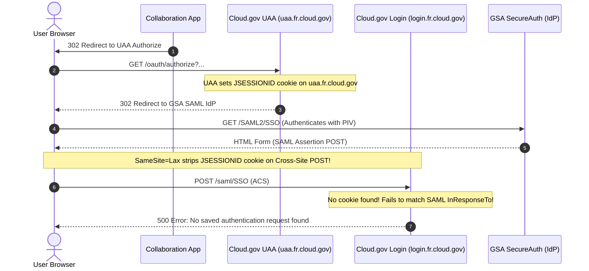

# Cloud.gov OIDC/SAML Split-Domain Session Mismatch & SameSite Cookie Constraints

This document provides a comprehensive technical analysis of the authentication errors encountered when attempting to bind GSA Collaboration Containers directly to Cloud.gov's Single Sign-On (SSO) Identity Provider (UAA). It details the architectural root causes of the issue and outlines action-oriented remediation options for GSA-TTS engineers.

---

## 1. Executive Summary & Problem Statement

When attempting to log into collaboration containers (such as Planka, Outline, or HedgeDoc) using native OpenID Connect (OIDC) integrations bound to Cloud.gov, users consistently encounter the following error from Cloud.gov's User Account and Authentication (UAA) server after GSA SecureAuth (PIV) authentication:

```
The response contained an InResponseTo attribute [ARQ...] but no saved authentication request was found
```

This error is a **platform-level cryptographic and browser session mismatch** caused by the split-domain architecture of Cloud.gov (`uaa.fr.cloud.gov` vs. `login.fr.cloud.gov`) combined with modern browser security policies (specifically, the `SameSite` cookie enforcement on cross-site POST requests).

Because of this constraint, **native, application-level SAML/OIDC integrations inside thin collaboration containers are fundamentally incompatible with Cloud.gov's current identity provider setup.** 

To secure these containers, TTS should standardize on a **Dedicated Gateway Proxy (`oauth2-proxy`)** architecture rather than trying to configure native authentication inside each individual application.

---

## 2. Technical Root-Cause Analysis

The authentication failure occurs during the SAML 2.0 Web Browser SSO profile exchange between the user's browser, Cloud.gov UAA, and GSA SecureAuth (the third-party SAML Identity Provider). 

### The Split-Domain Mismatch (DNS & Cookie Scope)
1. **The Authorization Request:**
   * The application redirects the user's browser to the Cloud.gov authorization endpoint on `https://uaa.fr.cloud.gov/oauth/authorize`.
   * Cloud.gov's UAA receives this request, saves the authentication request ID (mapping it to the SAML `InResponseTo` parameter), and sets a session cookie named **`JSESSIONID`** in the user's browser.
   * Crucially, this `JSESSIONID` cookie is scoped to **`uaa.fr.cloud.gov`**.

2. **The SAML Assertion Postback:**
   * Cloud.gov redirects the browser to GSA SecureAuth (e.g., `secureauth.gsa.gov`), where the user authenticates using their PIV card.
   * GSA SecureAuth generates a SAML Assertion containing the encrypted user profile, signed with the GSA certificate, and wraps it with an `InResponseTo` attribute matching the original request ID.
   * SecureAuth sends an HTML form to the browser that automatically **POSTs** this SAML Assertion back to Cloud.gov's Assertion Consumer Service (ACS) endpoint.
   * However, Cloud.gov's ACS endpoint is hosted on a separate domain: **`https://login.fr.cloud.gov/saml/SSO`**.

### The Modern Browser sameSite Cookie Block
Because of the split-domain architecture, the browser-facing handshake is fractured across `uaa.fr.cloud.gov` and `login.fr.cloud.gov`:
* **Under traditional cookie rules (pre-2020):** Browsers would send the `uaa.fr.cloud.gov` cookies to `login.fr.cloud.gov` if they were configured as a shared wildcard domain (e.g., `.fr.cloud.gov`).
* **Under modern browser security specifications (SameSite=Lax by default):** 
  * Modern browsers (Chrome, Safari, Edge, Firefox) enforce strict `SameSite` policies.
  * When a third-party site (like `secureauth.gsa.gov`) performs a **POST** request back to `https://login.fr.cloud.gov/saml/SSO`, the browser classifies this as a cross-site write.
  * Unless the `JSESSIONID` cookie was explicitly set with `SameSite=None; Secure`, **the browser completely strips the `JSESSIONID` session cookie from the incoming POST request.**

### The Handshake Failure
When Cloud.gov's ACS on `login.fr.cloud.gov` receives the SAML Assertion, it tries to read the `JSESSIONID` cookie to retrieve the saved authentication request ID and verify it against the SAML `InResponseTo` parameter. 

Since the cookie was either scoped to `uaa.fr.cloud.gov` (which is invisible to `login.fr.cloud.gov`) or stripped by the browser's `SameSite=Lax` protection, **the server finds no active session, cannot find the original request ID, and aborts with the `InResponseTo ... no saved authentication request was found` error.**



---

## 3. Detailed Remediation Options

GSA-TTS has three main architectural paths to resolve or bypass this split-domain cookie constraint.

### Option A: Standardize on Dedicated Gateway Proxies (`oauth2-proxy`) (Recommended)

Instead of trying to implement native OIDC/SAML clients inside every collaboration application, TTS should deploy a lightweight **`oauth2-proxy`** gatekeeper container alongside each application.

```mermaid
graph TD
    User([User Browser]) -->|1. Public Route: login.fr.cloud.gov| Router[Cloud.gov Gorouter]
    Router -->|2. Domain Unified SSL Handshake| Proxy[oauth2-proxy Container]
    Proxy -->|3. Container-to-Container (.apps.internal)| App[Collaboration Container]
    
    Proxy -.->|4. Skip Issuer Verification| UAA[login.fr.cloud.gov]
```

* **How it works:**
  * The public route maps to `oauth2-proxy`, which handles all session cookie management on the browser side.
  * `oauth2-proxy` is configured to use the unified domain `https://login.fr.cloud.gov/oauth/token` as its OIDC Issuer URL.
  * To bypass strict OIDC issuer verification (since the discovery document lists `uaa` but we are using `login`), we enable:
    `OAUTH2_PROXY_INSECURE_OIDC_SKIP_ISSUER_VERIFICATION="true"`
  * `oauth2-proxy` sets its own session cookies securely using `SameSite=Lax` on the app's domain, completely bypassing the UAA's internal SAML session cookie failures.
  * Once authenticated, `oauth2-proxy` forwards the request privately to the collaboration container (e.g., Planka or HedgeDoc) via Cloud.gov container-to-container private routing (`.apps.internal`).
* **Why it's superior:**
  * **Zero Code Modification:** No need to write custom patches or monkey-patch third-party applications (Planka, HedgeDoc, Outline, etc.).
  * **Isolation of Security Concerns:** The collaboration containers can remain completely stateless and unconcerned with SAML, OIDC, or certificate handshakes.
  * **Highly Maintainable:** Upgrading the collaboration container never breaks the authentication layer.
  * **Standardized Auditing:** Out-of-the-box support for GSA PIV card email extraction and authorization headers.

---

### Option B: Programmatic Domain Unification (App-Level Patching)

If a proxy is absolutely not allowed, and the application must use a native OIDC client, we must bypass the split-domain handshake programmatically on container boot.

* **How it works:**
  * Configure the OIDC issuer URL in the manifest as `https://uaa.fr.cloud.gov/oauth/token`.
  * Write a Node.js shell wrapper that executes before Planka/Outline starts. This wrapper reads the OIDC client library (e.g., `openid-client`) or hook config inside the container and programmatically replaces `uaa.fr.cloud.gov` with `login.fr.cloud.gov` across all discovered endpoints (Authorization, Token, JWKS, Userinfo) **in-memory** during startup.
* **Why it fails on strict OIDC clients:**
  * Many robust, modern OIDC libraries (including Node's `openid-client` and Go's OIDC library) strictly validate that the `issuer` string returned by the discovery document matches the issuer URL requested by the application.
  * If we query `login.fr.cloud.gov` but the discovery document returns `uaa.fr.cloud.gov/oauth/token`, the client library throws a **Mismatched Issuer Exception** and halts, unless the library explicitly supports a "skip issuer verification" option (which most application-level native implementations do not expose).
  * This option is highly brittle, subject to container file system changes during application upgrades, and difficult to maintain.

---

### Option C: Platform-Level DNS & Cookie Unification (Cloud.gov Core)

This is a platform-level fix that must be implemented by the Cloud.gov core infrastructure team, rather than the space developers.

* **Remediation Actions:**
  1. **Unify Domains:** Move Cloud.gov UAA and SAML Assertion Consumer endpoints onto the exact same domain origin (e.g., `uaa.fr.cloud.gov/saml/SSO` instead of `login.fr.cloud.gov/saml/SSO`), eliminating the split-domain session boundary entirely.
  2. **Modernize Cookies:** Configure the Cloud.gov UAA server to explicitly set `SameSite=None; Secure` on the `JSESSIONID` cookie. This instructs modern browsers to preserve and pass the session cookie during GSA SecureAuth's cross-site POST backchannel Assertion, resolving the `InResponseTo` missing session error.
* **Cons:**
  * Setting `SameSite=None` has strict FedRAMP and cross-site scripting (XSS) compliance implications, and must undergo security review by the platform engineers.
  * Out of scope for individual space/agency tenant developers.

---

## 4. Key Takeaways & Recommendations for GSA-TTS

1. **Abandon Native OIDC/SAML Integrations for Cloud.gov:** Native OIDC clients in third-party collaboration containers are designed for unified, standard OIDC providers (like Okta, Keycloak, or Google). They do not have the custom parameters needed to bypass Cloud.gov's split-domain SAML constraints.
2. **Standardize on `oauth2-proxy` Gatekeepers:** Securing downstream collaboration containers via `oauth2-proxy` is the most secure, robust, and industry-standard pattern for multi-tenant PaaS environments.
3. **Template the Proxy Architecture:** Establish a reusable, standard Cloud.gov manifest template combining `oauth2-proxy` with container-to-container private networking (`.apps.internal`). This can be dropped in front of *any* container (Planka, HedgeDoc, Etherpad, Excalidraw, etc.) to immediately gain secure GSA PIV Single Sign-On.
